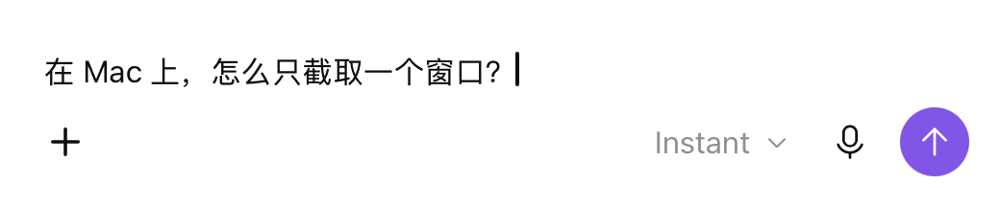

# chatgpt-quick-chat

Press **Option–Space** to chat with ChatGPT from anywhere on your Mac.

Sometimes you just want to ask a question and follow up. Chat is built for that, and you can save your Work and Codex allowance for tasks that need it. In the new desktop app, though, Option–Space opens Work. ChatGPT Classic still has the familiar chat shortcut, but its in-app notice says support will end in 2027. Classic also uses the older reply layout and can't display the visuals and interactive elements available on the web.

We built **chatgpt-quick-chat** to bring that shortcut back with the same answers and formatting you get on the ChatGPT website.

## How it works

The app opens ChatGPT in a small, native macOS window using WebKit’s embedded browser (WKWebView). You sign in with your own account. The website handles messages, image uploads, and replies. The app adapts the layout to fit the window.

Press **Option–Space** and a chat bar appears near the bottom of your screen. Type a question or paste an image.



Send your message and the window expands upward so you can read the reply and ask a follow-up. Press **Option–Space** again to hide it. By default, reopening it within 30 minutes resumes the conversation. You can change that interval in the menu bar.


## Build and run

You'll need macOS 14 or later and the Swift toolchain included with Xcode. From the project directory, run:

```sh
bash scripts/build.sh
open build/chatgpt-quick-chat.app
```

To sign in for the first time, open the full ChatGPT page from the app’s menu bar menu. The app source is in `Sources/ChatPanel/`, and the build scripts are in `scripts/`.
