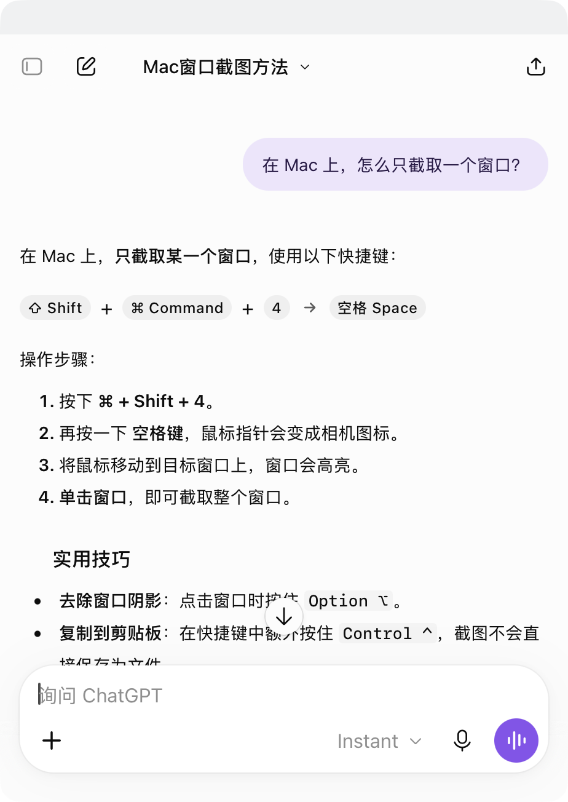

# chatgpt-quick-chat

在 Mac 上按 **⌥ Space**，直接和 ChatGPT 聊天。

有时候我们只想问个问题，再顺着回答聊两句。ChatGPT 的 Chat 模式就很适合这种用法，日常提问也可以把 Work 和 Codex 的额度留给手头的任务。但更新到新版桌面应用后，按 ⌥ Space 唤出的是 Work。想用熟悉的快捷键直接聊天，还得回到 ChatGPT Classic。

Classic 也有两个问题。按客户端提示，它将在 2027 年结束支持。它用的还是旧版回答排版，网页版能在回答里直接展示的图示和交互内容，在 Classic 里看不到。

所以我们做了 **chatgpt-quick-chat**，把 ChatGPT 网页版放进一个随时能唤出的 macOS 浮窗。

## 它是怎么工作的？

浮窗里嵌了一个浏览器（WKWebView），直接打开 ChatGPT 官网。用自己的账号登录，输入、上传图片和显示回答都由官网处理。我们调整了网页在小窗口里的布局：按 ⌥ Space 时，屏幕下方只露出输入框，可以直接打字或粘贴图片。


发送后，浮窗向上展开，按网页版的排版显示回答。看完再按一次 ⌥ Space 就能收起。默认 30 分钟内再次唤出可以接着聊，时限可在菜单栏调整。



## 从源码运行

需要 macOS 14 或更高版本，以及 Xcode 的 Swift 工具链。在项目目录运行：

```sh
bash scripts/build.sh
open build/chatgpt-quick-chat.app
```

首次登录可从菜单栏选择「显示完整页面」。应用代码在 `Sources/ChatPanel/`，构建入口在 `scripts/`。
